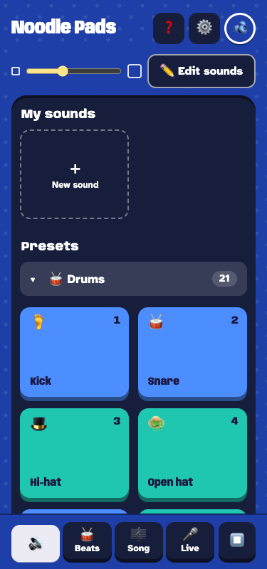
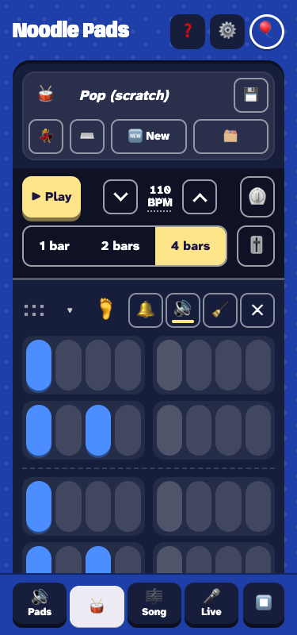
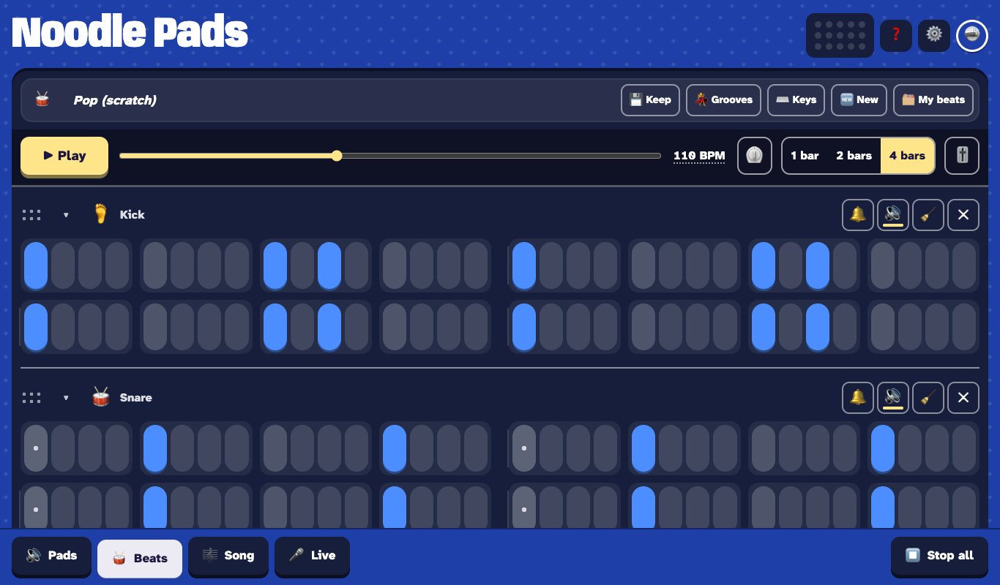

# Noodle Pads 🔊

A music studio anyone can pick up: kids, families, and grown-ups who love
music but don't have the time for a pro studio. It starts as a soundboard: tap
a pad, make a noise, annoy your family. Every next tool is one tap away, so you
learn by goofing around, never by lessons: record your own sounds, add silly
voices, make beats and whole songs. Goofing around counts as much as finishing
a song. Everyone in the family gets a board of their own.

**Play it at https://noodlepads.com**, on a phone, a tablet or a computer.
Nothing to install. No ads. No required account. No social feed. No AI makes
the music for you. What we measure is only to make the app better.

<p>
  
  
</p>


## What you can do

The bar at the bottom has two sides: **🎉 Play** (Pads and Live) and **🛠️ Make** (Beats and Song).

- **🔊 Pads:** tap to play, hold to loop (several at once); a scroll never plays one. Record a sound or add a file, then trim it, chop it into pads, or give it a voice: Chipmunk, Monster, Robot, Underwater and more, stacked and tweaked with knobs. Pick who plays the notes, chords and bass: piano, strings, marimba, steel drum, flute and more.
- **🥁 Beats:** tap pills on a grid. ⌨️ Keys plays sounds like a keyboard and records into the beat, 💃 Grooves gives 51 ready-made beats, 🎹 the piano roll writes tunes, and 🎚️ the mixer sets each row's loudness and effect.
- **🎼 Song:** line beats up in lanes, like a playlist, and play the whole song.
- **🎤 Live:** play the keys over a click track and keep each take.
- **🧸 Kids:** four picture screens for a five-year-old: big pads, a hold-to-record mic, a simple beat and toy keys.
- **☁️ The cloud:** each person's board follows them to any device once a grown-up puts them in the cloud with a PIN. Share a sound, beat or song with a code.
- **💾 Backups:** save everything to one file and load it on any device.
- **📲 Install it:** add it to the home screen (Android: Install app; iPhone and iPad: Share → Add to Home Screen). After one visit it opens with no network.

Every part in detail: [docs/guide.md](docs/guide.md). What each release added: [CHANGELOG.md](CHANGELOG.md).

## Run it

Plain HTML, CSS and JavaScript modules: no build step and no dependencies.
You need [just](https://github.com/casey/just) and Python 3 to run it, and
Node.js for the tests.

```
git clone https://github.com/pdxfixit/noodlepads.git
cd noodlepads
just serve
```

Then open http://localhost:8765/. Run `just` in the repo's folder: from
anywhere else it finds a different justfile. `just serve` prints a Wi-Fi
address too, for a phone or tablet on the same network. Recording needs
https or `localhost` (browsers only allow the microphone there); the live
site is https, and `just phone <serial>` forwards the dev server to an
Android phone on adb (not yet tried on a real device).

Without a cloud behind it, the app says "The cloud isn't reachable from
here" and everything else works.

## Test

```
just test
```

A syntax check, then Node's built-in test runner; nothing to install. Judge
it by the exit code. A test file whose report the runner cut short runs again
alone, and counts. The tests have no browser: `just look` checks every
screen width in a headless Chrome and saves screenshots.

## Running it yourself

Everything needed to keep Noodle Pads going has a `just` recipe, no agent
required. Run them in this repo's folder; `just` lists them all, and
`just doctor` checks this Mac first. Recipes that change the live site or
the cloud database show what they would do, or ask, before they do it.

| Task | Recipe |
|---|---|
| Is this Mac ready? | `just doctor` (tools, flarepress at `~/src/flarepress`, `~/.config/noodlepads/cloud.json`, the Keychain token) |
| Run it here | `just serve`; on an Android phone `just phone <serial>`, undone by `just phone-off <serial>` |
| Test | `just test` (judge by the exit code); `just stress` for a test that fails only sometimes |
| Look at every screen width | `just look` (`--wide` adds the big screens; `just look --help` lists views) |
| Deploy | GitHub deploys every push to `main` (`.github/workflows/deploy.yml`); from the Mac, `just deploy` (asks first). `just deploy-check` and `just deploy-plan` change nothing |
| What is live, and roll back | `just live`; `just rollback` prints the steps; `just live-check` is the daily check |
| Check the live cloud | `just deploy-checks` runs `just cloud-smoke` and `just cloud-e2e` (each makes and deletes its own test profile), and `just taps` on the live site |
| Check a finger's taps sound | `just taps`: a phone in headless Chrome taps 🔊 Pads, 🎤 Live and 🧸 Kids, fresh, after 🛠️ Make and back, and after a freeze and thaw; each must sound |
| Back up the cloud database | `just cloud-backup` (a `.sql` file in `~/.local/state/noodlepads/backups/`) |
| Look in the cloud database | `just cloud-profiles`, `just cloud-stats`, `just cloud-sql "SELECT …"`, or any wrangler command with `just cloud-db …` |
| Change the cloud database | `just cloud-migrate` (then `--yes`; the deploy runs it too, so by hand only for a drop); `just cloud-prune` (then `--yes`); `just cloud-reset-pin "<fun name>"` (then `--yes`: a random PIN, shown once); `just cloud-schema` for a new, empty database only |
| Bring problem reports and metrics home | `python3 ~/src/telemetry/telemetry.py pull`: the telemetry runner (pdxfixit/telemetry) harvests them, and this copies its store to `~/.local/state/telemetry/telemetry.sqlite3` |
| Problem reports | `just logs`, `--errors`, `--digest` read them from that copy |
| Move the old Mac archives into the runner (once) | `just runner-export all LOGS METRICS OUT` (both in the one file to import), `just runner-export check FILE` (docs/how-to.md, "Retire the old Mac archives") |
| Has a council seat stopped finding things? | `just council-tripwire` (a seat whose last 10 reviews were all a plain pass; `docs/council.md`) |
| Make sounds and emoji lists | `just placeholders`, `just emoji`, `just preset-loudness` (how loud each preset plays on a phone; `--fix` evens them out) |

Agents use the rest: `just setup` (the git hooks, once per clone), `just ship`, `just land`, `just land-continue`, `just ci-wait` (waits for a commit's GitHub runs), `just policy` (copies
`docs/privacy-policy.md` to the privacy site's repo once a change to it is on main; `--dry-run` stops before landing),
`just archive-agent`, `just prove`, `just version` (the release in
`web/version.js`, bumped with every change to `web/`), and the steps a deploy runs itself
(`just stamp`, `just deploy-verify`).

Deploying uses [flarepress](https://github.com/pdxfixit/flarepress) and the site
folder `site/`: [docs/deploy-cloudflare.md](docs/deploy-cloudflare.md).

## Docs

| Doc | What it holds |
|---|---|
| [docs/guide.md](docs/guide.md) | How the app works: every screen, and how sounds, beats and songs are stored |
| [docs/layout.md](docs/layout.md) | The file map |
| [docs/formats.md](docs/formats.md) | The backup format, field by field |
| [AGENTS.md](AGENTS.md) | How to work on this repo, for people and coding agents: start, verify, ship, the rules |
| [docs/how-to.md](docs/how-to.md) | Step by step: a bug fix, a stored-format change, landing, deploy and rollback |
| [docs/decisions.md](docs/decisions.md) | Every rule decided so far, and why |
| [docs/adr/](docs/adr/README.md) | Why the biggest decisions were made |
| [CHANGELOG.md](CHANGELOG.md) | What each release has |

## Privacy

The app links the full policy from ⚙️ Settings and Help. Here are the
plain words on the cloud (`web/privacy.js`; `tests/privacy.test.mjs` keeps
this copy the same and ties the claims to the code).

**🔓 What's private (not much)**

- Nobody goes to the cloud by themselves. A grown-up puts someone there: ☁️ In the cloud in their profile, a sum, then a PIN for them.
- In the cloud, Cloudflare stores for noodlepads.com: each profile's fun name, avatar and color, their sounds, beats, songs, recorded voices and settings, and the names you give them.
- Anyone who opens noodlepads.com sees the list of the 300 most recently used profiles: their fun names, avatars and colors, whether each has a PIN, and when its look last changed.
- Anyone who has a sound's link can play it. The links are long and random, but they are not secret.
- Anyone with a share code can see and play what was shared, until the sharer taps 🚫 Unshare or their profile is deleted. Remixes others made of it stay theirs. Removing it from Shared with me only takes it off your list.
- Everyone in the cloud has a PIN. It is not security: it only stops someone opening or changing a profile in the app.
- A device that remembers a profile (🔑 Remember on this device) opens it with no PIN until someone taps Forget this device. Sharing from it still asks the PIN.
- The app asks for no real names, emails or accounts. Profile names are made up by the app; nobody types one.
- To stop one visitor using up the cloud's new profiles, each network address may add 3 a day. The cloud counts them with a scrambled code made from the address and the date, never the address itself, and forgets the code the next day. The address is never stored, logged or shown.
- Everyone else stays on this device only. Remove PIN, or switching ☁️ In the cloud off, deletes their cloud copy and keeps this device's. Links they shared stop working.
- A song 🎧 From a song listens to is heard only in this browser, as it plays: it is never saved, synced or sent. Only the beats made from it are kept.
- While 📊 play data is on, a profile in the cloud also counts when and how often it is opened and synced, with the country, the browser, system and device type, and a scrambled code for each device that opens it. Never an address or city. Kept 14 days, a device's row 90 days, and our own copy up to a year.
- Cloudflare, our host, also counts page views, without cookies. It is the only outside site the app talks to.
- Problem reports, on unless someone switches them off, send this device's cleaned event log (no sounds and no names), its settings, how many sounds, beats and songs it has, its browser, system and device type (never the full browser string), its screen size, time zone and sound timing, the app's version, and random codes for this device and this visit. They are deleted from the cloud about 14 days later, once the site is next used. Nothing is sent while the 📊 play data switch in ⚙️ Settings is off. A device where nobody chose sends one only after an error or a tap that made no sound. A tap that made no sound adds the screen, what was tapped, how far the tap got, what lay on top of it, an open dialog, the audio's state and how long the page had run.
- Feedback is sent only when a grown-up answers a sum and taps Send in ⚙️ Settings → About → Feedback: only what they typed, and the app's version. Only the people who make the app read it, and it is deleted after 90 days. No name or IP address is stored with it.
- To delete a profile and everything in it: 👥 People, tap them, tap Delete twice, then ☁️ Delete their cloud copy too twice, or Remove PIN, or switch ☁️ In the cloud off (tap it twice), to keep this device's own copy. Each asks for their PIN. It is gone from the cloud at once, with every share code it made.

What the app sends about how it is used, and how long it is kept, is in the full policy, shared by every pdxfixit app: [Privacy policy](https://privacy.pdxfixit.com/noodlepads/).

## License

[MIT](LICENSE).
