# The cloud needs a PIN

**Status:** built (2026-10-27), in the plan's order: leaving brings the latest here first (section 0), the Worker and migration 009, then the app. A plan and a mockup, approved by Ben (2026-10-26) and reviewed by six council seats (2026-10-27); their findings and Ben's answers of 2026-10-27 are folded in below. Calls made while building: the section 3 e2e steps and the look views are written but the e2e runs only live; the dropped-quietly 404 is said to a screen reader only (`announce`); `leaveCloud` for a locked device opens a session key with the typed PIN before it syncs. The rule is Ben's (decisions.md, Hosting and data: "The cloud needs a PIN"); this file says how it works, what it touches, and in what order.

**Already true when this is built** (Ben, 2026-10-27; another agent builds them first): 🔑 Remember lasts until Forget this device, a PIN change, or the cloud drops the key after 180 days unused (no 90-day clock on the device); 🔗 Share always asks the PIN, even on a remembered device; 🔑 Forget this device asks the grown-up sum first.

**Answer first.**

- **Nobody goes to the cloud by themselves any more.** A new person, and everyone already on a device, stays on that device until a grown-up turns their ☁️ on.
- **Turning ☁️ on is four short steps:** the grown-up sum, a new PIN, the same PIN once more, then 🔑 Remember them here? (Not now first). The first PIN pad says what becomes public. Then they are in the cloud, synced.
- **Leaving the cloud is Remove PIN** (or ☁️ off, the same thing): a red second tap asks first, then the PIN; their latest is brought here first, then their cloud copy and shared links are deleted, and this device keeps everything. If their latest can't be brought here, nothing is deleted.
- **The Worker makes, lists and opens only profiles with a PIN**, refuses a PIN removed through the API, and treats any profile without one as not there (404, never 401).
- **One additive migration** (009: a second wrong-PIN counter for requests that carry a key). No stored-format change, no backup change. All three live profiles have PINs already.

## 0. First, on its own: leaving never loses work

Today's 📴 out of the cloud (`web/cloud.js setOffline`, on) deletes the cloud copy without pulling first, so a sound pushed only from another device is lost. Fix that before anything else, in its own commit: `setOffline` runs `syncNow` and sends the `DELETE` only if that sync came back ok (a report, status `ok`). Otherwise it says "Couldn't bring their latest here; try again." and deletes nothing. `leaveCloud` (section 1) keeps the same rule. Test with two fake devices: a sound pushed only by B is on A after A leaves; with the sync failing, A's link and the cloud profile both stay.

## 1. What a kid and a grown-up see

The screens below are rough: drawn on a throwaway draft, then the draft was thrown away. Each is at 320, 375 and 1100 px. Lines changed since (the consent line, "A grown-up picks this PIN", the leave note) are given in words; the build checks them with `just look`.

### Turning ☁️ on

What it costs a grown-up: one sum, four numbers typed twice, one tap on the Remember offer. Four dialogs, each one thing. (Folding the Remember offer into the Once-more pad's success was weighed: one dialog fewer, but that pad has no room left at 320×680. It stays its own dialog, as approved.)

1. **👥 People → tap someone.** Their profile sheet shows ☁️ In the cloud, switched off: "Only on this device. A grown-up can put them in the cloud with a PIN, to open them on any phone or tablet." The whole switch row is the target, at least 44 px tall. The 🔒 PIN part is gone until they are in the cloud: a PIN now means the cloud, so there is nothing to set on its own. ⬇️ Back up stays.

   | 320 | 375 | 1100 |
   |---|---|---|
   | 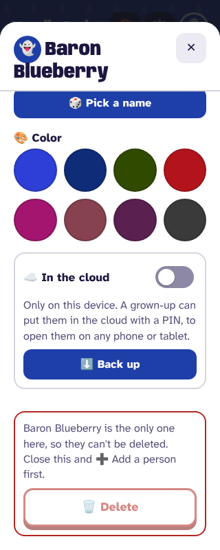 | 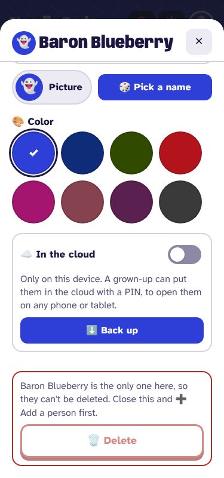 | 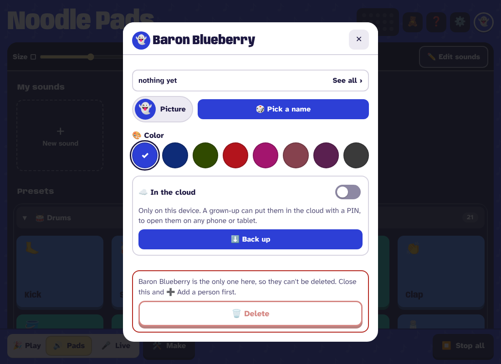 |

2. **Tap the switch: the grown-up sum** (`grown-up.js askSum`, the same one ⚙️ in 🧸 Kids and Feedback ask; Ben, 2026-10-27: no stronger gate), with one new line under its title saying why: "☁️ To put 🔔 Happy Giraffe in the cloud". The line is set with `textContent` (the fun name and picture come from records). A wrong answer says so and asks another (`stay: true`, as Feedback does); three wrong in a row start the 30 s wait. ✕ or Esc leaves the switch off and sends nothing.

   | 320 | 375 | 1100 |
   |---|---|---|
   | 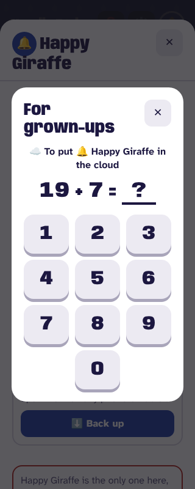 | 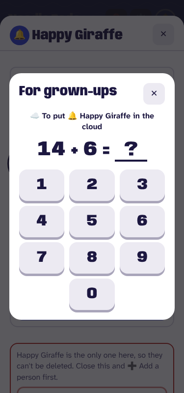 | 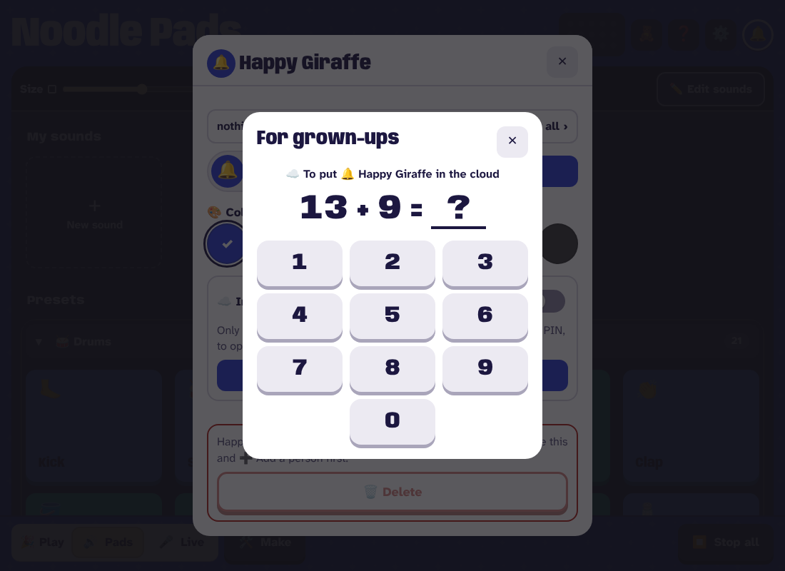 |

3. **The PIN pad: "☁️ Pick their PIN"**. Under the title: "A grown-up picks this PIN. Four numbers, asked each time they are opened, on every device." Then the consent line, in a box of its own over the dots:

   > Their sounds, beats and recorded voices are stored on noodlepads.com. Anyone can see their fun name and picture, and play a sound of theirs if they have its link.

   Then **Once more**, as every new PIN is typed twice (decisions.md); a second that doesn't match says so and starts again. ✕ at either pad leaves them on this device and sends nothing: the profile is made only after the second pad.

   **Fits a short phone.** The mockup is about 780 px tall. At 320 and 375 wide and `--height 680` (a phone with its browser bar), the dots and all ten keys stay on screen without scrolling: the boxed line is kept to its words at a smaller size, and if it still doesn't fit, the part above the dots scrolls and the keys never do.

   | 320 | 375 | 1100 |
   |---|---|---|
   | 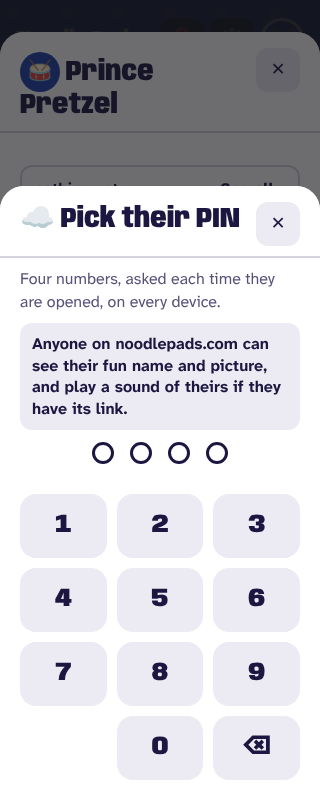 | 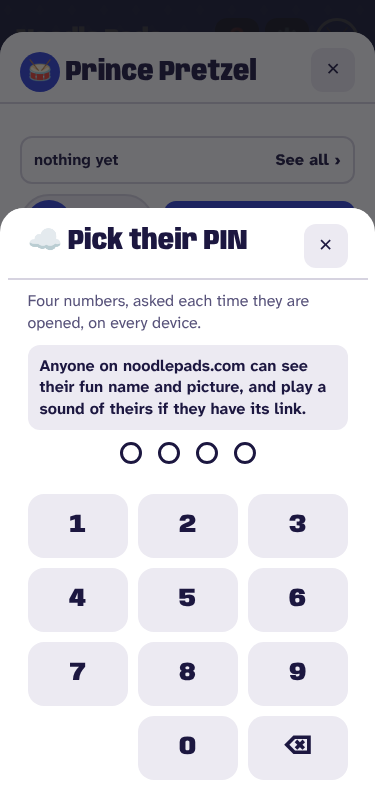 | 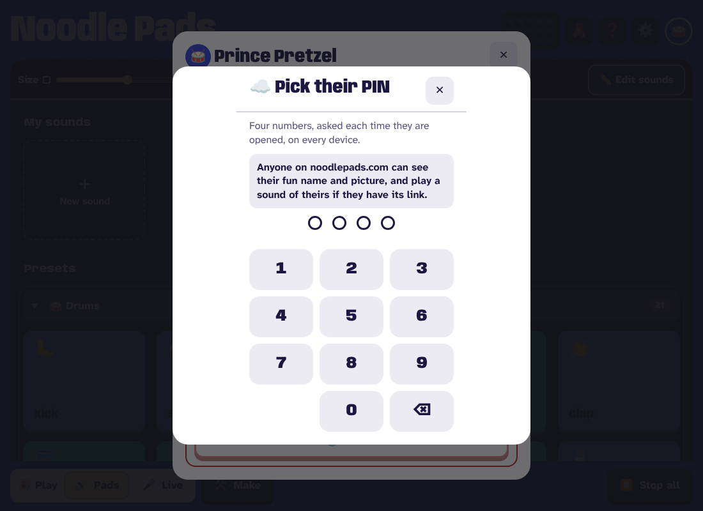 |

4. **Done.** `goUp` first saves a pending link (the id, no key, `pin: true`, and the PIN's `check`), then makes the profile with the PIN in one request, then saves the key and syncs at once ("Putting them in the cloud…", then "In the cloud ✓ Opens on any phone or tablet, with their PIN."). A tab that dies mid-create reopens with a link that asks for the PIN just picked: if the profile was made, that PIN opens it; if not, the open gets 404 on a link that never synced, which drops quietly ("Not in the cloud yet. A grown-up can put them there."), switch off. The PIN pill says "✅ In the cloud, PIN set" for 3 s, then "🔒 PIN on". The PIN part shows Change PIN, Remove PIN and 🔑 Remember on this device, with "Removing it takes them out of the cloud."

   Then **🔑 Remember them here?** opens, the same offer a PIN open makes. Its first line: "Anyone using this device can open them." **Not now** comes first and has the focus; 🔑 Remember is second. ✕ or Esc is Not now: they stay in the cloud, not remembered.

   | 320 | 375 | 1100 |
   |---|---|---|
   | 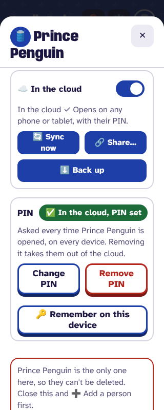 | 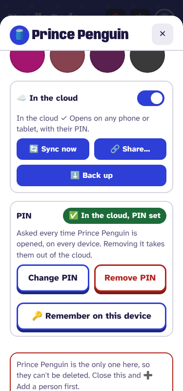 | 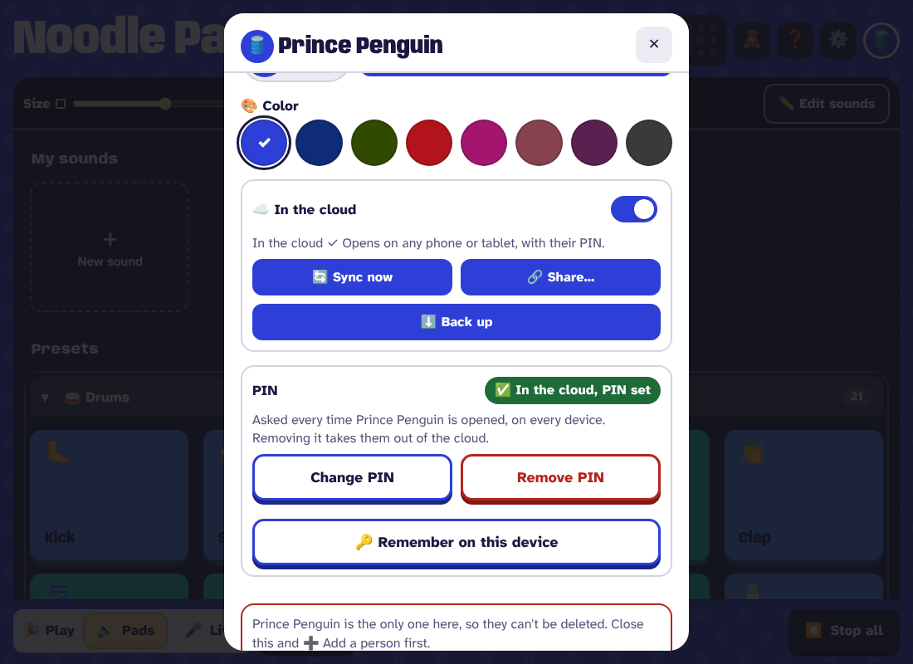 |

What can go wrong on the way, and what it says:

| Case | What happens |
|---|---|
| No network, or the cloud resting | The switch stays off; the line under it says `cloudTrouble`'s sentence ("The cloud isn't reachable from here…"). The pending link is dropped and the PIN typed is not kept: the next try asks the sum and PIN again. |
| They are already in the cloud (restored here from a backup, or still there from another device) | The Worker answers 409. The app never tries the PIN just picked against it: ids come from backups, which are untrusted, and a common PIN could join another family's profile. The pending link is dropped and a pad of its own opens: "Already in the cloud with a PIN. Type that one to join up." Its PIN opens them (link saved with that PIN's `check`); ✕ leaves them on this device. The first sync then merges with no base (section 8). |
| A profile row with no PIN, made by hand in D1 | 409 on create, then 404 on the join pad's open. The switch stays off; the line says "Something in the cloud is in the way. Nothing was sent." `just cloud-profiles` marks the row 🔓 no PIN; Ben deletes it (a TODO "Ben does" line). Section 4's check before the deploy finds none today. |
| 10 new profiles today, or 1,000 in all | 429 / 507, said as today; the switch stays off; the pending link is dropped. |

### Someone who made things before this ships

They stay on the device. Nothing of theirs is sent, nothing is deleted, and no notice interrupts the kid. Their profile sheet shows the switch off with the line above. A person already in the cloud (all three live profiles, each with a PIN) is unchanged on every device.

### Leaving the cloud

- **Remove PIN** turns red on the first tap: "Leave the cloud?". Directly under that red button, the note: "Tap again, then type the PIN: their cloud copy is deleted for every device, and links you shared stop working. This device keeps everything."
- The second tap opens the PIN pad. ✕ or Esc there sends nothing and leaves them in the cloud. The PIN typed runs `leaveCloud(personId, pin)`:
  1. No key here (a locked device): open with the PIN for a session key first.
  2. `syncNow`. Only if it came back ok does anything get deleted; otherwise "Couldn't bring their latest here; try again." and the link, the key and the cloud copy all stay.
  3. `DELETE /api/profiles/:id` with the key and the PIN. A wrong PIN says how many tries are left; nothing is deleted.
  4. Drop the link and the bases; the sheet shows the switch off.
- **☁️ off** does exactly the same, with the same words, from the switch.
- **Undo:** none (Ben). Everything stays on this device, so a slip costs the sum, a new PIN, and the share codes they had made (deleted with the profile).
- **Other devices with them:** the next sync gets 404 `profile` (section 2: a key whose profile is gone now answers 404, not 401), drops the link, and keeps every record and sound there. It says: "Taken out of the cloud on another device; everything here stays here." That replaces today's "…Switch Offline off to put it back." (`web/cloud.js` sync's 404 branch), which also no longer writes `offline: true`.

| 320 | 375 | 1100 |
|---|---|---|
| 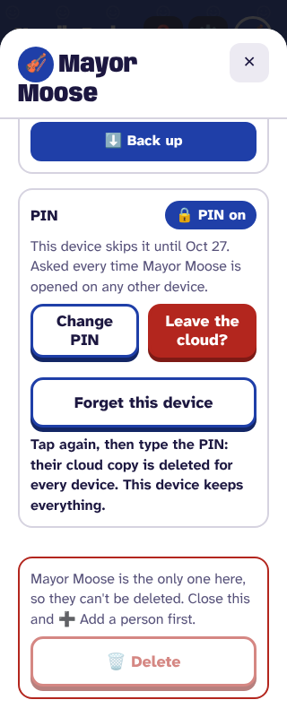 | 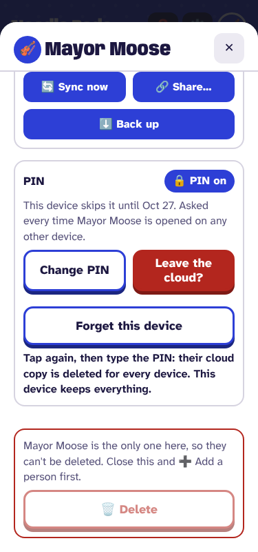 | 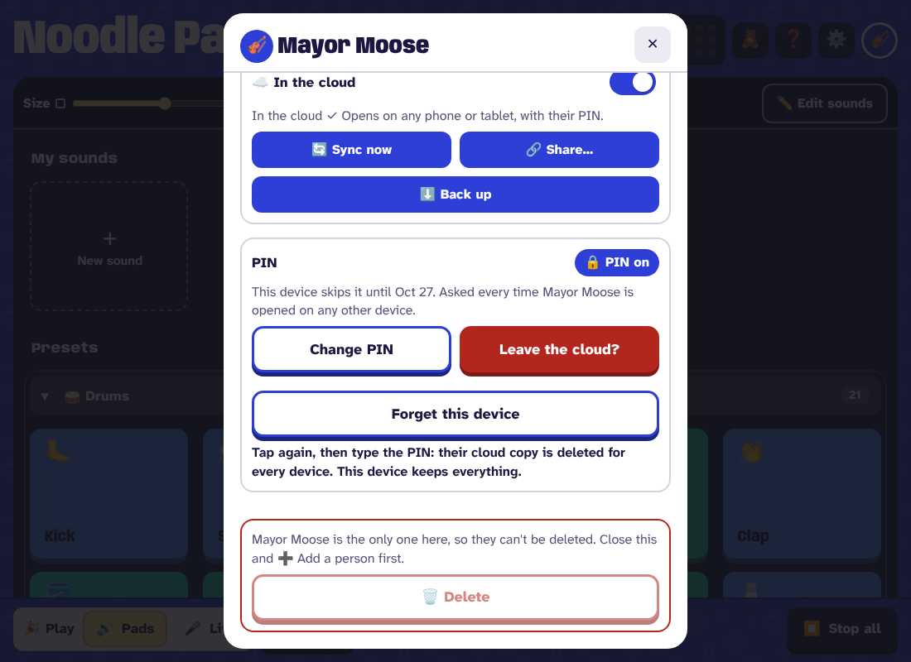 |

(The leave shots are on a device that remembers the PIN, so their PIN part shows "Forget this device"; the words on the red button and the note are the point. The note's words are now the ones above.)

**Change PIN** is unchanged: the current PIN, then a new one twice. **🗑️ Delete** in the red box is unchanged: two taps delete them here; then ☁️ Delete their cloud copy too asks "☁️ Tap again to delete their cloud copy" first (`left.asked`, `unaskCloud()` and the `left?.id === id` branch in `people.js onProfileClick`, commit 2962615), and only the tap after it asks the PIN and deletes. That ask stays for everyone (Ben). The plan does not touch that code.

### Sharing

🔗 Share needs them in the cloud. It never puts anyone up:

- **Their profile's 🔗 Share** shows only in the cloud, and asks the PIN every time (Ben, 2026-10-27).
- **✏️ Edit sounds' bulk Share** is disabled, with the reason in the bar's `why` line, while the person is only on this device: "Put them in the cloud (their profile, ☁️) to share." (`web/bulk.js drawBar`, beside the presets' reason).
- **`shareItem`** loses its `if (!inCloud(personId)) await syncAll()`: someone not in the cloud gets "Put them in the cloud first to share." and nothing is sent.

### Opening from the cloud: unchanged

👥 People's ☁️ Open from the cloud, and the welcome's ☁️ Open from the cloud beside Skip, work as now. Every profile listed has a PIN, so every pick asks it; 🔑 Remember is offered after. The 🔒 badge on each line stays (it is true of all of them now).

### On another device: keys and 🔑 Remember

A PIN is asked on every open on every device unless 🔑 Remember holds: until Forget this device (which asks the grown-up sum first), a PIN change, or 180 days without use. A device linked before this ships keeps its key. A PIN changed elsewhere still asks here once ("They have a new PIN"), with 🤷 I don't know the PIN. `keyRefused`'s branch that reopens a listed profile with no PIN ("Opened again: its PIN was cleared.") goes: no such profile is listed now.

### Tabs from before

A tab still running the old app gets 400 `needs pin` where it would put someone up. Its words are fixed in its own code: "The cloud said no (needs pin). Everything is still here on this device." That says nothing was lost; the update bar's 🆕 (within 10 minutes) is what says to reload. Section 4 has the rest.

## 2. The Worker

| Request | Today | After |
|---|---|---|
| `POST /api/profiles` with a `pin` that fails `isPin` (missing, `null`, `""`, a number, 3 digits) | 201 with no PIN (missing, `null`, `""`); 400 `pin` otherwise | 400 `{error: 'needs pin'}`, for all of them (`makeProfile`'s check becomes `if (!isPin(body.pin))`, and the `body.pin ? …` salt and hash lose their `?`). `cloudTrouble`: "A grown-up puts someone in the cloud, with a PIN, in their profile." |
| `POST /api/profiles` with a 4-digit `pin` | 201 | unchanged (the app sends it now; cloud-smoke already does) |
| `GET /api/profiles` | every profile, newest 300 | `AND pin_hash IS NOT NULL` in the same SQL, before the 300 |
| `POST …/open` on a profile with no PIN | a key | 404 `profile`, as if it were not there (`getProfile` filters on `pin_hash IS NOT NULL`) |
| Any keyed route (pull, push, sounds, shares, PATCH, DELETE) for a profile with no PIN | works | 404 `profile`. `keyProfile`'s one `SELECT` joins `profiles` and reads `pin_hash IS NOT NULL`, so it costs no extra query, and returns three results: no key (→ `needKey` 401 `key`), **no PIN** (→ `needKey` 404 `profile`), or the profile's id. The app's 404 path drops the link. |
| Any keyed route whose key isn't found | 401 `key` | 401 `key` while the profile is there with a PIN (a PIN change closed the key); 404 `profile` once it is gone or has no PIN. Only on this failure path, `needKey` reads `SELECT 1 FROM profiles WHERE id = ? AND pin_hash IS NOT NULL`. This is what lets another device hear that someone left (section 1). |
| `PATCH` with `newPin: null` (Remove PIN through the API) | clears the PIN, every key deleted | 400 `{error: 'needs pin'}`. Nothing changes. The app leaves by `DELETE`, which already needs the key and the PIN. A PIN change is one `UPDATE` from one hash to the next, so a profile with a PIN never reads as 404 mid-change. |
| The PIN on a keyed request (PATCH `pin`, `DELETE`, and 🔗 Share's PIN wherever the Worker checks it) | counted in `fails` / `locked_until`, the same counter `/open` fills | counted in `key_fails` / `key_locked_until` (migration 009), which only a request with a key can fill. 5 wrong: 10 minutes, as for opening. A stranger's 5 wrong `/open` calls then lock only opening, never Leave, Remove PIN, Change PIN or Delete on a device that has the key. `checkSecret` (`worker/pin.js`) takes which pair of columns to count in. |
| `GET /api/sounds/:id`, `GET /api/shares/:code` | public | unchanged |

A profile with no PIN can then exist only by hand (`just cloud-sql`). It is unreachable and unlisted; `just cloud-profiles` marks it "🔓 no PIN", and Ben deletes it.

**`just cloud-reset-pin`** (`tools/cloud_admin.py reset-pin`) never clears a PIN. It makes a random 4-digit PIN that Ben passes on, never 1234 (built 2026-10-27). Its write is one `UPDATE` that sets the new hash and salt and zeroes both counters (`fails`, `locked_until`, `key_fails`, `key_locked_until`), never a clear and then a set, with the keys' `DELETE` in the same call: no moment where the profile has no PIN and reads as gone. decisions.md's row on a forgotten PIN loses "(or clears it)", and docs/how-to.md "Reset a forgotten PIN" its last paragraph's first sentence.

## 3. The deploy checks

- **cloud-smoke** already makes its throwaway profile with a random PIN. Add three steps: a create without a PIN is refused 400 `needs pin`; a `PATCH newPin: null` is refused and the PIN still opens it; 5 wrong `/open` PINs, then the `DELETE` with the key and the right PIN still works (the two counters are apart).
- **cloud-e2e** today relies on a person going up by themselves (`syncAll`), which ends. New steps:
  1. A makes the person and a beat and a sound, runs `syncAll`, and checks the person is **not** in the cloud (no link, `GET /api/profiles/:id/open` 404). This is the rule itself, checked live.
  2. A puts them up with a PIN through the same function the switch calls after the sum and the pads (`cloud.js goUp(personId, pin)`).
  3. B opens them from the ☁️ list with `data-pin="true"`, typing the PIN on the real PIN pad (`#pin-keys`), then says Not now to 🔑 Remember.
  4. Clean-up: the fallback that opened the profile with no PIN opens it with the PIN; the "a device's own first person went to the cloud too" branch goes, since that can't happen now.
- `just taps` is untouched.

## 4. Older copies of the app

The service worker serves the network first, so a reload gets the new app. A tab left open from before:

- its `syncEveryone` tries to put someone up without a PIN and gets 400: that person shows ☁️⚠️ with "The cloud said no (needs pin). Everything is still here on this device." until the tab reloads. The update bar asks for that reload within 10 minutes.
- its Remove PIN gets 400 and says so; nothing is lost.
- its ☁️ switch on gets the same 400.
- its 📴 off deletes as today (without the sync first, unless section 0 shipped before it loaded).

No device holds a link to a profile without a PIN today: before deploying, check `just cloud-sql "SELECT id FROM profiles WHERE pin_hash IS NULL AND id NOT LIKE 'p-smoke-%' AND id NOT LIKE 'p-e2e-%'"` returns nothing (reads only).

## 5. Every file to touch

| File | Change |
|---|---|
| `worker/cloud.js` | `makeProfile` refuses any `pin` that fails `isPin` with 400 `needs pin`; `listProfiles`, `getProfile` and `keyProfile` see only profiles with a PIN; `keyProfile` returns no key / no PIN / the id, and `needKey` turns no PIN, or a key whose profile is gone, into 404 `profile`; `changeProfile` refuses `newPin: null`; `needPin` takes which counter (open or keyed). |
| `worker/pin.js` | `checkSecret` counts in the columns it is given (`fails`/`locked_until` for `/open`, `key_fails`/`key_locked_until` for keyed requests). |
| `worker/migrations/009-key-fails.sql`, `worker/schema.sql` | `ALTER TABLE profiles ADD COLUMN key_fails INTEGER NOT NULL DEFAULT 0` and `key_locked_until` the same. Additive: the old Worker runs on it until the upload. |
| `web/cloud.js` | First (section 0): `setOffline` syncs before it deletes. Then: `wantsCloud` goes, and `syncEveryone` puts nobody up. `putUpNow` becomes `goUp(personId, pin)`: `funNamed`, the pending link (`pin: true`, `check`, no key), `api.create` with the PIN, the key saved, `unlocked` and `pinTyped` set, then `syncNow`. 409 → drop the pending link, return "joins" for the join pad, never an open with the new PIN. `setOffline` becomes `leaveCloud(personId, pin)`: a key if none, `syncNow`, the `DELETE` only after a good sync, then drop the link and bases. No more `offline` writes; `isOffline` goes (an old record's `offline: true` is ignored and kept). The 404 `profile` path drops the link only, with its own words; on a link that never synced, quietly. `keyRefused`'s no-PIN reopen goes. `setPin(…, null)` goes. `shareItem` loses its `syncAll` put-up. |
| `web/cloud-sync.js` | `hasMade` and `MADE` go (their only reader was `wantsCloud`), with their tests. |
| `web/cloud-ui.js` | Switch on: `askSum` with `why`, then `askNewPin` with the public line, then `goUp`, then `offerRemember`; on "joins", the join pad. Switch off and Remove PIN: armed "Leave the cloud?" with the note under it, then the PIN, then `leaveCloud`. `askPin` gets `shown` (the boxed line). `offerRemember`: "Anyone using this device can open them." first, Not now focused. `cloudText` and `drawPin`: the new lines; the PIN part hidden while not in the cloud; `#cloud-pin` (🔒 Set a PIN) goes. `cloudLabel`: its 📴 branch goes; no ☁️ bit for someone only on this device (today a bare ☁️ meant "not yet"), ☁️✓ 🔒 in the cloud. `FORGOT_PIN` unchanged. |
| `web/bulk.js` | Share disabled, with its reason, for someone not in the cloud (`drawBar`); it needs `inCloud` through its hooks. |
| `web/cloud-api.js` | `cloudTrouble` for `needs pin`. |
| `web/grown-up.js` | `askSum({ why })`: the line under the title, set with `textContent`, hidden when empty. Its header comment names the third asker. |
| `web/index.html` | `#kids-sum-why`; `#pin-public`; an id on the PIN part; `#cloud-pin` goes; Not now `autofocus` in `#remember-dialog`; the comments over the sum and the profile sheet. |
| `web/styles.css` | `.kids-sum-why`, `.pin-public` (a chalk box, as in the mockup, kept short enough for 680 px). The ☁️ switch row 44 px tall. Contrast suite stays green: chalk and ink are in it. |
| `web/people.js` | `alone = isOffline(...)` becomes `!inCloud(...)`; the header comment. Delete's "Tap again" on the cloud copy (`left.asked`, `unaskCloud`) stays exactly as it is; `left.pin` is now always true for someone in the cloud, so its key-only branch (`key: pin ? null : keyOf(id)`) only serves a link from before. |
| `web/help.js` | The ☁️ In the cloud line (a grown-up turns it on, with the sum and a PIN; Remove PIN or ☁️ off leaves, and shared links stop working), the 🔒 Set a PIN line goes, the Change PIN / Remove PIN line says Remove PIN leaves the cloud. |
| `web/log-clean.js`, `web/track-page.js` | `cloud {up: true}` and `cloud {left: true}` in `RULES.cloud`; `appEventOf` maps them (`'up'`, `'leave'`) in place of `put`/`offline`. `put`, `offline` and `pin: 'removed'` stay readable for old logs; no new code writes them. |
| `../telemetry/events.toml` | Lines for `up` and `leave`, in the same landing. A Mac step: that repo is beside the main checkout only, so `just test` there after landing (AGENTS.md, Verify). |
| `web/backup.js` | The comment on `offline` (`cleanPeople`): still read and kept, ignored since this change. |
| `web/privacy.js`, `README.md` | Section 7. `PRIVACY`'s first line is rewritten in the build commit. |
| `web/state.js` | The comment naming `wantsCloud`. |
| `tools/look-cloud.mjs` | Section 3. |
| `tools/look.mjs` | Views `cloud-off`, `cloud-sum`, `cloud-pin`, `cloud-pin-again`, `cloud-remember`, `cloud-leave`; `cloud` and `cloud-in` follow the new sheet. |
| `tools/cloud_admin.py`, `justfile` | `reset-pin`: a random PIN in one `UPDATE` (built 2026-10-27); `profiles` marks a profile with no PIN. |
| `docs/adr/0002-…md` | Rewritten: section 6. |
| `docs/decisions.md` | Row "The cloud needs a PIN" loses "(to build)"; the ☁️ switch row (2026-10-19) is replaced by this flow; the forgot-PIN row loses "(or clears it)"; "Profiles live in the cloud" says "people a grown-up put there"; the sprawl row's "Nobody who has made nothing goes to the cloud" goes (moot); leaving syncs first and deletes nothing if it can't; the switch asks the usual sum (Ben, 2026-10-27). |
| `docs/architecture/cloud.md` | "Who goes to the cloud", the routes table (404 vs 401, the two counters), "Three meanings of offline" (📴 Offline goes: two meanings left), the privacy-vs-code table, the link's readers, the pending link. `tests/architecture.test.mjs` with it. |
| `docs/architecture/data.md` | The `people` row's `offline?`: kept, ignored. |
| `docs/guide.md`, `docs/design/cloud-profiles.md`, `docs/how-to.md`, `docs/state.md`, `CHANGELOG.md`, `TODO.md` | Say what is true after (the guide: leaving makes links you shared stop working); state.md's "In flight" line and TODO's line go when it lands; TODO "Ben does": publish the shared policy the same day, after the deploy (section 7). |

## 6. ADR 0002, rewritten

Same title and number (Ben: "we don't need historical ADR"). What changes:

- **In short:** "Everyone who makes something is a profile…" becomes "A person goes to the cloud only when a grown-up puts them there, with a PIN; everyone else stays on their device."
- **Decision:** "Offline is the exception" is replaced by **"The device is the default."** New people stay on the device. ☁️ on asks the grown-up sum, a PIN typed twice, and shows one line on what becomes public. Removing the PIN brings their latest here, then deletes the cloud copy. **PIN:** required, 4 digits; the Worker makes, lists, opens and serves only profiles with one.
- **Options turned down** gains: "Everyone up once they make something, Offline as the way out (2026-10-11 to 2026-10-26): a kid's voice went public with no grown-up step." It loses "Putting people in the cloud by a tap: Ben chose everyone". New: "A PIN optional in the cloud: the list would show profiles anyone could open." "A grown-up account or email: collects what a family toy should not." "A stronger gate than the sum (Ben, 2026-10-27: the usual sum)."
- **Consequences** gains: fewer profiles in the list and on the free plan; a grown-up step before a second device works; a person never put up has no cloud backup (⬇️ Back up is the way).
- **Decided by** adds Ben, 2026-10-26 and 2026-10-27.

## 7. Privacy: `web/privacy.js`, README, the shared policy

`tests/privacy.test.mjs` keeps README's list equal to `PRIVACY`. Changes, word for word:

- First line → "Nobody goes to the cloud by themselves. A grown-up puts someone there: ☁️ In the cloud in their profile, a sum, then a PIN for them."
- "A PIN is not security…" → "Everyone in the cloud has a PIN. It is not security: it only stops someone opening or changing a profile in the app."
- "People with ☁️ In the cloud switched off stay on this device only." → "Everyone else stays on this device only. Remove PIN, or switching ☁️ In the cloud off, deletes their cloud copy and keeps this device's. Links they shared stop working."
- The deleting line keeps "then ☁️ Delete their cloud copy too twice" and ends: "…or Remove PIN, or switch ☁️ In the cloud off (tap it twice), to keep this device's own copy. Each asks for their PIN." (no "if it has one").

The consent line on the first PIN pad (section 1) says the same as these lines, voices included.

The shared policy (pdxfixit/privacy) says the same, and goes out the same day, right after the deploy (a TODO "Ben does" line until TODO's "The privacy site pulls Noodle Pads' policy from this repo" makes that one file). README's feature line: "each person's board follows them to any device once a grown-up puts them in the cloud with a PIN."

## 8. Migrations, stored formats, backups

- **D1:** one, `009-key-fails.sql`: two columns with defaults, additive (section 2). `pin_hash` already exists; the PIN rule itself is in the Worker's SQL.
- **IndexedDB:** none. The `offline` field on people records is left as it is (read, kept, ignored). The pending link uses fields a link already has (`key: null`, `pin`, `check`).
- **Backups:** none. A backup carries no link; a restored person stays on the device until a grown-up turns ☁️ on (409 → the join pad). `backup.js` still reads `offline`.
- **Bases after leaving:** leaving drops the merge bases with the link. A later go-up that joins a profile already there (409, then its PIN) merges with no base: anything on both sides is kept, as two where they differ, never one side dropped.

## 9. Tests

Each fails without its change (`just prove`):

| Test file | What it checks |
|---|---|
| `tests/cloud-sync.test.mjs` (section 0, first) | two fake devices: a sound pushed only by B is on A after A leaves (`setOffline`, then `leaveCloud`); with A's sync failing, nothing is deleted, A's link stays and the cloud profile is still there; "Couldn't bring their latest here; try again." |
| `tests/worker-cloud.test.mjs` | create with `pin` missing, `null`, `""`, `1234` (a number) or `"123"` → 400 `needs pin`; the list leaves out a profile with no PIN (one put in by SQL); open, pull and push on it → 404 `profile`; a profile with a PIN never answers 404, including another device's key after a PIN change (401 `key`); after `DELETE`, another device's key → 404 `profile`; `PATCH newPin: null` → 400 and the PIN still opens it; 5 wrong `/open` PINs leave `DELETE` and `PATCH` with the key and right PIN working, and 5 wrong keyed PINs lock only keyed ones. Its helper makes every test profile with a PIN. |
| `tests/migrations.test.mjs` | 009 and `schema.sql` agree (as for every migration). |
| `tests/cloud-ui.test.mjs` | the switch asks the sum first; a wrong sum leaves it off and sends nothing; ✕ at the sum, the first pad or Once more sends nothing; the right sum and a PIN twice make one `create` carrying the PIN; the pending link is saved before `create`, and a start with only it opens with that PIN; the first pad shows the consent line and "A grown-up picks this PIN"; a 409 opens the join pad and sends no open with the new PIN; 409 then 404 leaves the switch off, no link, "in the way"; Remove PIN arms, its note sits right after the button, then asks the PIN, then syncs, then deletes, and every record is still here; ✕ at that PIN pad sends nothing; Remember's Not now is first and focused, and ✕ or Esc leaves them in the cloud; the 404 `profile` path says the new words, writes no `offline`, and every record and blob is still here. |
| `tests/bulk.test.mjs`, `tests/cloud-sync.test.mjs` | bulk Share is disabled, with its reason, for someone not in the cloud; `shareItem` for someone not in the cloud sends no create and no sync. |
| `tests/delete-cloud.test.mjs` | unchanged and still green: ☁️ Delete their cloud copy too asks "Tap again" before the PIN, for a person who went up through the new flow too. |
| `tests/cloud-sync.test.mjs`, `tests/new-ids.test.mjs`, `tests/pin-new.test.mjs`, `tests/sync-timing.test.mjs` | a person with sounds is not put up by `syncAll`; the tests that relied on it put up with `goUp`; a join after leaving keeps both sides (no base). |
| `tests/privacy.test.mjs` | ~133: the Worker refuses a create with no PIN, and `syncAll` for a person with sounds makes no create (in place of the `wantsCloud` regex and `hasMade`). ~140: "Everyone in the cloud is in that list" lists two profiles with PINs and leaves out a no-PIN row; "the list has no filter" goes from the title. Plus the new `PRIVACY` lines. |
| `tests/help.test.mjs`, `tests/architecture.test.mjs`, `tests/log-clean.test.mjs` | the new labels and claims; `up` and `leave` pass `RULES`, and old `put`, `offline` and `pin: 'removed'` events still do. |
| `tests/telemetry.test.mjs` | `up` and `leave` are in `events.toml` (runs on the Mac only). |
| `tools/test_cloud_admin.py` | `reset-pin` writes one `UPDATE` that never sets `pin_hash` NULL and zeroes both counters; `profiles` marks no PIN. |
| `just look --wide` | the views `cloud-off`, `cloud-sum`, `cloud-pin`, `cloud-pin-again`, `cloud-remember`, `cloud-leave` and `cloud-in` at all nine widths, `.kids-sum-why` and `.pin-public` among them; then `cloud-sum`, `cloud-pin`, `cloud-pin-again` and `cloud-remember` at 320 and 375 with `--height 680`: each fits, and the PIN dots and keys are all on screen. |
| live, after the deploy | cloud-smoke and cloud-e2e (section 3). |

## 10. Risks

| Risk | Size | Answer |
|---|---|---|
| A kid of 7 or more answers the sum (12 to 39 plus 6 to 9) | medium | Ben accepted it (2026-10-27): the usual sum, the agreed grown-up step (Kids, Feedback). The PIN then guards the profile anywhere. |
| Leaving loses a sound pushed only from another device | high today | Section 0: sync first, delete only after a good sync. |
| A backup's id plus a guessed PIN joins another family's profile | medium | The 409 path never tries the PIN just picked; the join pad asks for the one they have, and the 5-try wait applies. |
| A stranger's wrong PINs lock a family out of leaving | medium | The keyed counter (section 2). A key holder gets 5 more tries per 10 minutes than before; it already has the profile. |
| A grown-up forgets the PIN just set | low | The email path: Ben makes a random PIN and passes it on; the device keeps everything either way. |
| A tab from before the deploy shows ☁️⚠️ for someone | low | Its words say nothing was lost; it reloads on the update bar's 🆕. |
| Remove PIN by mistake deletes share codes | low | The red second tap, the note "links you shared stop working", and the PIN first. |
| The PIN pad doesn't fit a short phone | medium | Checked at 320 and 375 by 680 (section 9); the keys never scroll. |
| Fewer kids reach a second device | intended | Ben's rule. The welcome's ☁️ Open from the cloud still works for anyone a grown-up put up. |

## Ben's answers

2026-10-26:

- The flow as shown is approved, to build after the bug sweep's cloud branch lands and the six seats have reviewed this plan.
- No Undo after leaving the cloud: the red second tap and the PIN ask first, and the device keeps everything.
- Both ways out stay, ☁️ off and Remove PIN, with the same words ("Leave the cloud?").
- 🔑 Remember is offered right after the grown-up sets the PIN.
- The "Tap again" ask on ☁️ Delete their cloud copy too (2962615) stays.

2026-10-27:

- 🔑 Remember lasts until Forget, a PIN change, or the cloud drops the key after 180 days unused.
- 🔗 Share always asks the PIN, even on a remembered device.
- 🔑 Forget this device asks the grown-up sum first.
- The consent line names the voices (section 1, step 3).
- A PIN reset makes a random 4-digit PIN that Ben passes on, never 1234.
- The ☁️ switch asks the usual grown-up sum, with no stronger gate.

Calls made here (say if any is wrong): the sum is asked every time the switch goes on, even just after 🧸 Kids' sum; the consent line sits on the first PIN pad, not a sheet of its own; a person only on this device shows no ☁️ in 👥 People; the 🔒 PIN part shows only in the cloud; the Remember offer stays its own dialog; the keyed PIN counter is two new columns (migration 009) rather than rows in `counters`, so it keeps the same 10-minute wait.

**Council** (2026-10-27): storage-sync ⛔→✅, architect ✏️, security ✏️, privacy-safety ✏️, parent ✏️, kids-ux ✏️; every finding folded in above.
