# ⬇️ Save as audio file on Beats and 🎼 Song

Status: mockup, for Ben's OK (2026-10-27). The screenshots come from a throwaway draft that was reverted, so no app code has changed. Ben approved the feature on 2026-10-26 (decisions.md, Product: "A beat or a song can leave the app as a WAV").

**The answer.** ⬇️ Save as audio file sits right after 🔊 Save as a sound, in both places that button already lives:

- **Beats** (⌨️ Keys off and on): in 🗂️ My beats, under 🔊 Make the open beat a sound. Both modes open the same dialog.
- **🎼 Song**: on the deck, after 🔊 Save as a sound.

On a phone each button takes a full line. On a wide screen the two sit side by side. One tap makes a WAV of what ▶ Play plays and hands it over:

- on a computer, as a download;
- on a phone or tablet, through the share sheet (Messages, AirDrop, Save to Files…), or as a download where the browser can't share a file.

The file is named after the beat or song (`Biscuit (House version).wav`). 🧸 Kids doesn't get the button: a grown-up gets a kid's beat out through ⚙️ and the sum. Regular and Advanced get the same button in the same place. It works offline and nothing goes to the cloud.

## What a kid sees

| | 320 px | 375 px | 1100 px |
|---|---|---|---|
| Beats, ⌨️ Keys off: 🗂️ My beats | 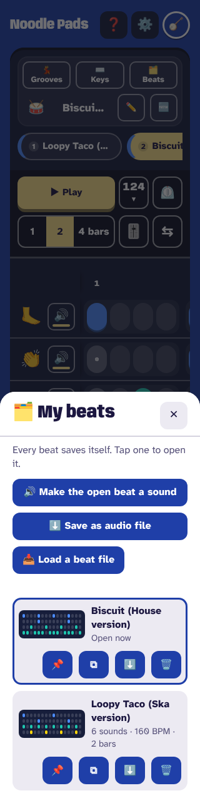 | 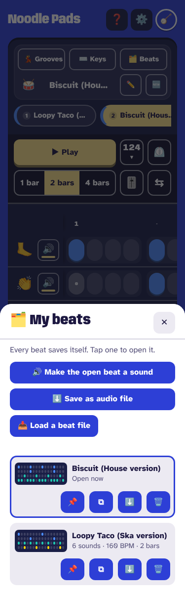 | 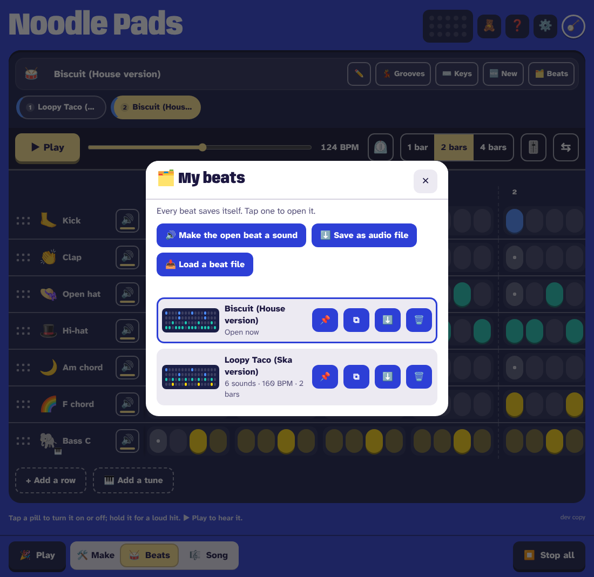 |
| Beats, ⌨️ Keys on: 🗂️ My beats | 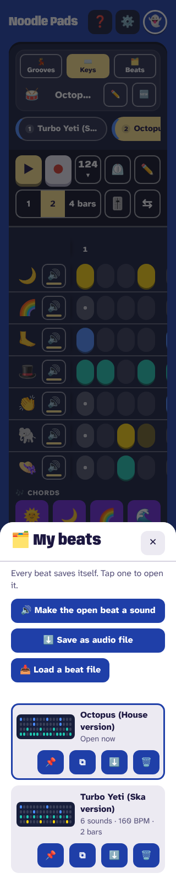 | 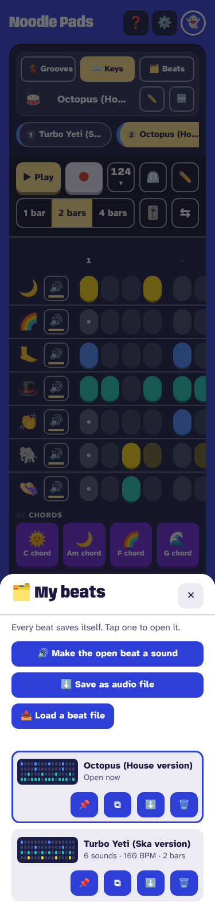 | 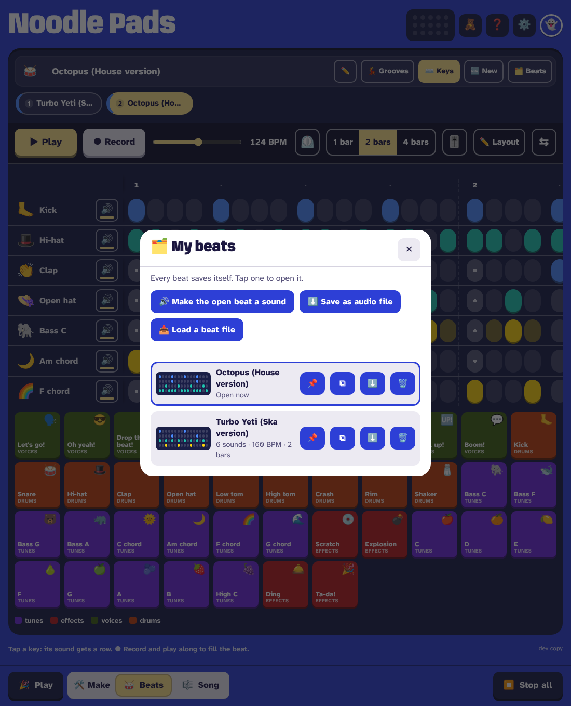 |
| 🎼 Song: the deck | 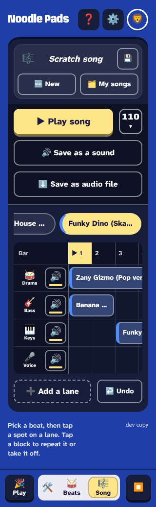 | 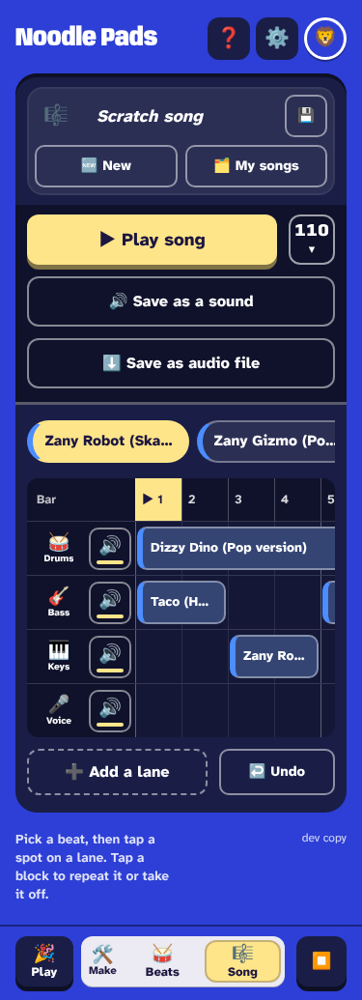 | 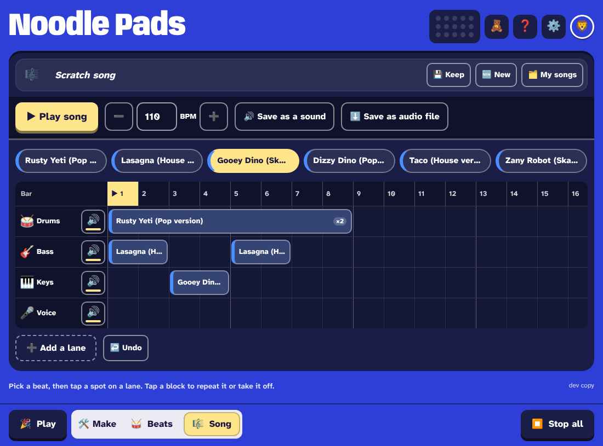 |

After a tap (on a computer, as a download):

| 🗂️ My beats: the line under the buttons, where 🔊 reports | 🎼 Song: the floating notice, where 🔊 reports |
|---|---|
| 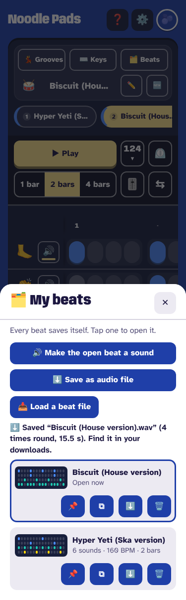 | 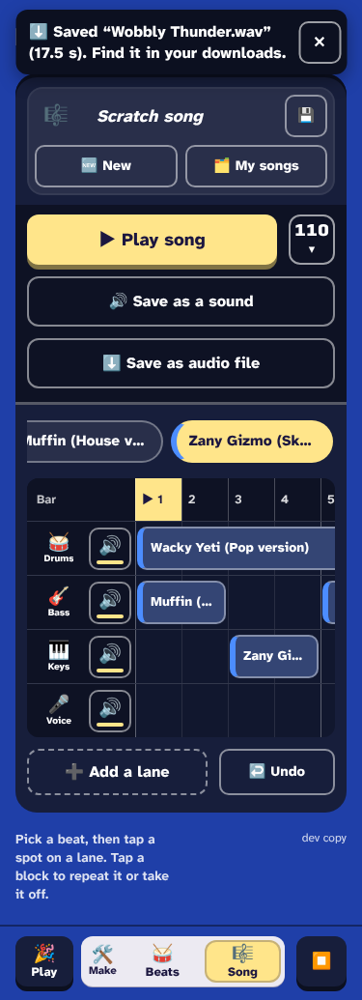 |

`just look` passed at all three widths in every view: nothing scrolls sideways, there are no console errors or CSP blocks, and no control is under 44 px. Each look run kept two grooves (Ska, House) so 🗂️ My beats has something in it.

## Options considered

**Where it sits on Beats**

| Option | For | Against |
|---|---|---|
| **A. In 🗂️ My beats, under 🔊 Make the open beat a sound** (recommended) | It sits where Ben asked: beside 🔊. One dialog serves Keys off and on, so nothing changes on the beat bar. | You need two taps to reach it, as with 🔊 today. |
| B. ⬇️ on every beat's card in 🗂️ My beats | Any beat can be saved without opening it first. | Each card already has a ⬇️ that saves the beat file. A beat that isn't open would also need its sounds loaded first. |
| C. A key on the beat bar | One tap. | The bar is a grid of 48 px keys with every column taken (decisions.md, 2026-10-26). It would push something into ⋯. |
| D. One 📤 Send menu holding the beat file, the audio file and a share code | One place for everything that leaves the app. | It's a new control and a bigger change. If sending grows, it could come later. |

**Song on a phone**

| Option | For | Against |
|---|---|---|
| **A. Two full-width lines** (recommended; the table above) | Full words. The pair reads together, like My beats. | The deck is 54 px taller. |
| B. One shared line with short words: 🔊 As a sound · ⬇️ As a file | Saves that line. | It renames today's 🔊 button on phones, and "As a file" doesn't say what kind of file. |

| Option B: 320 px | Option B: 375 px |
|---|---|
| 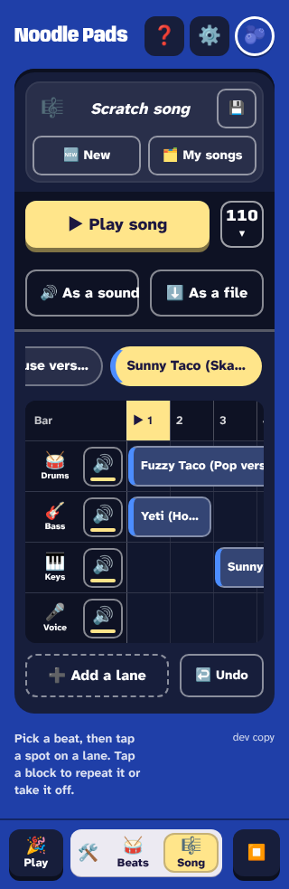 | 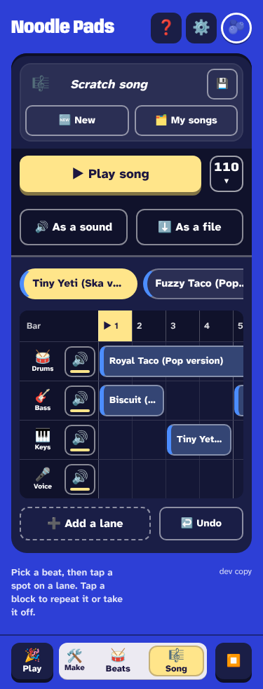 |

**On a phone: download or share sheet**

| Option | For | Against |
|---|---|---|
| Always a download | Simple and predictable. | On a phone the file lands in Downloads, which a kid (or a parent) won't find. Sending it means a hunt through Files. |
| **Share sheet on a touch device that can share the file, download elsewhere** (recommended) | "Sending what you made" is what the producer and amateur seats asked for. The sheet has Messages, WhatsApp, AirDrop, and Save to Files / Drive for keeping. | It needs a fresh tap (see below). |
| Ask each time (📤 Send or ⬇️ Save) | Both are always there. | It adds a choice to every save. |

**🧸 Kids**

| Option | For | Against |
|---|---|---|
| **No button in Kids** (recommended) | ADR 0019 says Kids has no sharing on screen. A stray tap by a five-year-old would fill a phone with files or open a share sheet to the family's contacts. A kid's beat is the scratch, which the regular app's Beats opens, so a grown-up gets it out with ⚙️ → the sum → 🥁 Beats → 🗂️ → ⬇️. | A grown-up can't save it from inside Kids. |
| A ⬇️ on 🧸 Kids' Beats, behind the grown-up sum | One step for a grown-up. | It's a new control and a second sum on Kids. |

**The file's name**

| Option | Example |
|---|---|
| **The name on screen** (recommended) | `Biscuit (House version).wav`, `Wobbly Thunder.wav` |
| With the app's name | `Biscuit (House version) - Noodle Pads.wav` |
| As backups are named | `noodlepads-biscuit-house-version-2026-10-27.wav` |
| With the tempo, for producers | `Biscuit (House version) 124 BPM.wav` |

## How it behaves on a phone

1. The tap renders the WAV in the background: about a second for a beat, a few seconds for a long song. The button says ⏳ Making the file… and can't be tapped, as 🔊 does today.
2. **On a computer** (`matchMedia('(pointer: fine)')`), and on any browser that can't share a file, `downloadBlob` saves it. The note (🗂️ My beats) or notice (🎼 Song) says: ⬇️ Saved "Name.wav" (15.5 s). Find it in your downloads.
3. **On a phone or tablet** whose browser can share the file (`navigator.canShare({ files: [file] })`; likely Chrome on Android and Safari on iPhone and iPad), `navigator.share({ files: [file], title })` opens the share sheet. Cancelling it changes nothing and shows no error.
4. **The catch:** a browser opens the share sheet only soon after a real tap. Chrome allows about 5 s, and Safari is likely stricter. A long song can take longer than that to render. If the share is refused (`NotAllowedError`), the button turns into 📤 Send "Name.wav". The file is ready, so one more tap opens the sheet at once.
5. iPhone Safari without sharing would download too. It asks "Download?", then puts the file in Files → Downloads.

Nothing new is needed in `web/_headers`: Web Share is allowed for the site's own page by default, and the download is a `blob:` link, which the CSP already allows for backups.

## The levels

| Level | Sees |
|---|---|
| 🧸 Kids | Nothing. The Kids screens have no 🗂️ My beats or 🎼 Song. |
| Regular | ⬇️ Save as audio file, as shown. |
| Advanced | The same button and the same file. Swing, row speed, the 🎚️ Mixer and tempo marks are in the file because they're in what plays. |

## How the WAV is made

Everything needed is already in the app. The new work is a few lines in each place, plus one helper that downloads or shares.

- **Beats**: `sequencer.js` `bounce()` is what 🔊 Make the open beat a sound uses. It loads the rows' sounds (`prepare`), books every hit with `planHits(pattern, playMode(), seconds, bar(), swingNow())` into an `OfflineAudioContext`, plays them through the beat's own mix (`busFor`: the 🎚️ Mixer, Overlap, fades), then evens the peak with `normalize`. So the file sounds like ▶ Play.
- **Song**: `song.js` `saveAsSound()` uses `planSong(song, …, { skipMuted: true })`, `seq.prepareBeats`, `soundSong` through `laneGainsFor` (the lane levels), then `normalize`. It has the same 3-minute limit (`MAX_SONG_SECONDS`) and the same message for a longer song.
- **To bytes**: `encodeWav(buffer)` (`sequencer.js`): 16-bit stereo PCM at the device's sample rate, as 🔊 stores it. A 15 s beat is about 2.9 MB, and a 3-minute song about 35 MB at 48 kHz.
- **Out**: `downloadBlob(blob, name)` (`download.js`), already used by backups and beat files, or `navigator.share` as above. Both would go in one new `saveAudio(blob, name)` in `download.js` that picks between them, so Beats and Song share it.
- **The name**: the cleaned beat-file name (`sequencer.js`, `[data-export]`) strips `(` `)`. The audio file would keep letters, numbers, spaces, `( ) ' _ -` and drop the rest (emoji, `/ \ : * ? " < > |`), up to 24 characters, then add `.wav`. A scratch beat is named as 🔊 names it: its groove's name, or a fresh fun name. A scratch song gets a fresh fun name, so five saves aren't five "Scratch song.wav" files. The 🔊 remix suffix ("🌀 Wonky Remix") isn't added: the file is the beat itself.

What the build touches, beyond the button:

- a ❓ Help line in Beats and Song (`help.js`);
- tooltips from `aria-label`;
- a `logEvent` action (`'audio'` on `beat` and `song`) with its rule in `log-clean.js`;
- tests for the name cleaner, the repeat count and the share-or-download choice (pure functions);
- `docs/guide.md`;
- `web/privacy.js` needs no change: the cloud stores and shows nothing new, and the file leaves only when the person sends it.

## Open questions for Ben

1. **How long is a beat's file?** A beat loops for as long as it plays, but one pass of a 1-bar beat is about 2 s, which is too short to send to anyone. **Recommend:** play it round until the file is at least 15 s (whole passes; 4 bars at a slow tempo is already one pass), and let the last hits ring out for up to 2 s, the same at every level. A producer who wants exactly one loop has 🔊 Save as a sound, which keeps one pass. A song's file is the song once through, with the same ring-out.
2. **Share sheet on phones?** **Recommend** yes, on a touch device that can share the file: the sheet opens, and a download is the fallback (above). The other choices are always a download, or asking each time.
3. **Two ⬇️ in 🗂️ My beats.** Each beat's card already has ⬇️ for "save as a beat file" (`.beat.json`), so the new ⬇️ Save as audio file would share its icon in one dialog. **Recommend:** the card's beat-file button becomes 📄 (tooltip "Save Biscuit as a beat file"), so ⬇️ always means the audio file. The other choice is to keep both as ⬇️.

The smaller calls, made here and changeable:

- Kids gets no button.
- The file is named as on screen.
- Song on a phone uses two full lines.
- The button reports where 🔊 reports.
